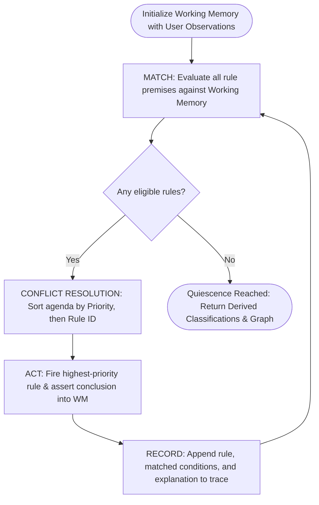

# RenalLogic AI: Artificial Intelligence Methodology

## 1. Classical Symbolic AI vs. Black-Box Neural Models

In medical risk assessment, explainability and clinical safety are paramount. While modern deep neural networks excel at perceptual pattern matching, they suffer from the "black-box problem": their decisions lack verifiable step-by-step logic, cannot cite authoritative clinical guidelines, and may produce hallucinated probabilities.

**RenalLogic AI** implements a **Classical Rule-Based Expert System** adhering to symbolic AI principles:
- **Deterministic and Traceable**: Every derived finding has an exact provenance chain.
- **Auditable Knowledge Base**: Clinical rules are codified declaratively from peer-reviewed international guidelines (KDIGO 2024).
- **Zero Hallucination**: No synthetic probabilities or black-box weights are generated; findings strictly represent logical deduction from explicit premises.

---

## 2. Knowledge Representation (KR)

Medical domain knowledge is represented declaratively in `backend/app/knowledge_base.json` using production rule syntax:

$$\text{Rule } R: \quad \text{IF } C_1 \land C_2 \land \dots \land C_n \quad \text{THEN } F = V$$

### Rule Schema
Each rule defines:
- **`id`**: Unique symbolic identifier (e.g., `R_GFR_G3B`, `R_CHRON_CONFIRMED`, `R_ASSESS_CONFIRMED_CKD`).
- **`name`**: Human-readable clinical rule title.
- **`category`**: Semantic classification (eGFR Staging, Albuminuria Staging, Marker Analysis, Chronicity Evaluation, Risk Matrix Integration, Clinical Synthesis, Etiology, Action Recommendations).
- **`priority`**: Integer precedence rank for agenda conflict resolution (lower number indicates earlier execution in deductive cascades).
- **`conditions`**: Antecedent premise list with relational operators (`==`, `!=`, `<`, `<=`, `>`, `>=`, `in`, `is_known`, `is_unknown`).
- **`conclusion`**: Consequent fact name and value asserted into working memory upon rule activation.
- **`explanation`**: Full clinical rationale explaining the physiological basis of the deduction.
- **`source`**: Specific citation referencing KDIGO 2024 guideline chapters or tables.
- **`review_status`**: Verification audit state (`verified_against_kdigo_2024`).

---

## 3. Working Memory & Three-Valued Kleene Logic

### Working Memory Architecture
Working memory maintains three distinct subsets of facts:
1. **User-Supplied Facts ($F_{\text{user}}$)**: Direct laboratory inputs (e.g., `egfr = 42`, `uacr = 120`).
2. **Derived Facts ($F_{\text{derived}}$)**: Assertions generated by fired production rules (e.g., `egfr_stage = "G3b"`, `chronicity_status = "Confirmed_Persistent"`).
3. **Explicit Unknown Facts ($F_{\text{unknown}}$)**: Missing, unasserted, or unavailable clinical data (e.g., `diabetes = UNKNOWN`).

### Three-Valued Kleene Logic for Uncertainty
In open-world medical scenarios, missing information must **never** be assumed to be false. Treating missing eGFR as "normal" or unconfirmed chronicity as "no CKD" creates dangerous clinical false negatives.

RenalLogic AI implements **Kleene 3-Valued Logic** ($\mathbb{K}_3$) with truth values $\{\text{TRUE}, \text{FALSE}, \text{UNKNOWN}\}$:

| $A$ | $B$ | $A \land B$ (Conjunction) | $A \lor B$ (Disjunction) | $\neg A$ (Negation) |
| :---: | :---: | :---: | :---: | :---: |
| **TRUE** | **TRUE** | **TRUE** | **TRUE** | **FALSE** |
| **TRUE** | **FALSE** | **FALSE** | **TRUE** | **FALSE** |
| **TRUE** | **UNKNOWN** | **UNKNOWN** | **TRUE** | **FALSE** |
| **FALSE** | **UNKNOWN** | **FALSE** | **UNKNOWN** | **TRUE** |
| **UNKNOWN** | **UNKNOWN** | **UNKNOWN** | **UNKNOWN** | **UNKNOWN** |

**Rule Firing Mandate:**
A production rule fires during forward chaining **if and only if** its premise conjunction evaluates strictly to $\text{TRUE}$. If any premise references an unasserted fact, the conjunction evaluates to $\text{UNKNOWN}$ ($None$), preventing premature or erroneous firing without assuming the fact is false.

---

## 4. Forward Chaining: Data-Driven Deduction

Forward chaining is a bottom-up inference strategy that starts with known facts and applies rules to deduce new information until no further rules can fire (quiescence / fixpoint).

### Match-Resolve-Act Algorithm
1. **MATCH**: Evaluate conditions for every rule in the knowledge base against current Working Memory using $\mathbb{K}_3$. Identify the set of rules whose premises are strictly $\text{TRUE}$ and whose consequents are not already asserted.
2. **CONFLICT RESOLUTION**: If multiple rules are eligible simultaneously (the *Conflict Set* or *Agenda*), order them deterministically:
   $$\text{Precedence}(R_i, R_j) = (R_i.\text{priority} < R_j.\text{priority}) \lor (R_i.\text{priority} == R_j.\text{priority} \land R_i.\text{id} < R_j.\text{id})$$
   This guarantees that staging rules (priority 10) fire before marker synthesis rules (priority 20), chronicity rules (priority 30), and risk composite rules (priority 40).
3. **ACT**: Fire the winning rule, add its consequent to $F_{\text{derived}}$, mark the rule as fired, and append a comprehensive entry to the execution trace.
4. **REPEAT**: Loop until no eligible rules remain or the safety iteration bound is reached.

---

## 5. Backward Chaining: Goal-Driven Hypothesis Prover

Backward chaining is a top-down inference strategy that starts with a target hypothesis query (e.g., `"Is kdigo_risk_category == 'Very_High'?"` or `"Is assessment_summary == 'Confirmed_CKD_Criteria_Met'?"`) and works backwards to determine whether available evidence supports it.

### Recursive Proof Algorithm
Given a goal $G = (Fact, Value)$:
1. **Base Case 1 (Direct Working Memory Match)**:
   - If $Fact \in \text{WM}$ and $\text{WM}[Fact] == Value \implies \text{SUPPORTED}$.
   - If $Fact \in \text{WM}$ and $\text{WM}[Fact] \neq Value \implies \text{NOT\_SUPPORTED\_BY\_AVAILABLE\_EVIDENCE}$.
2. **Base Case 2 (Cycle Detection Guard)**:
   - Maintain active goal path stack $S_{\text{goals}}$. If $G \in S_{\text{goals}}$, circular dependency is detected $\implies \text{UNDETERMINED}$ (halts recursion).
3. **Recursive Rule Examination**:
   - Query Knowledge Base for all candidate rules deriving $G$:
     $$\text{Candidates}(G) = \{ R \in \text{KB} \mid R.\text{conclusion.fact} == Fact \land R.\text{conclusion.value} == Value \}$$
   - If $\text{Candidates}(G) == \emptyset$ and $Fact \notin \text{WM} \implies \text{UNDETERMINED}$ (primitive fact is missing).
   - For each candidate rule $R$:
     - For each premise condition $C_k = (fact_k, op_k, val_k)$:
       - If $fact_k$ is known in WM, evaluate $C_k$.
       - If $fact_k$ is unknown, recursively invoke Backward Chaining for subgoal $G_k = (fact_k, val_k)$.
     - If all conditions are $\text{SUPPORTED} \implies R$ succeeds; goal $G$ is $\text{SUPPORTED}$.
     - If any condition is $\text{NOT\_SUPPORTED} \implies R$ fails.
     - If conditions are unresolved due to missing facts $\implies R$ is $\text{UNDETERMINED}$.
4. **Verdict Synthesis**:
   - If any candidate rule is $\text{SUPPORTED} \implies \text{SUPPORTED}$.
   - Else if any candidate rule is $\text{UNDETERMINED} \implies \text{UNDETERMINED}$ (reports missing required premises).
   - Else $\implies \text{NOT\_SUPPORTED\_BY\_AVAILABLE\_EVIDENCE}$.

---

## 6. Explainability Facility & Proof Graph Visualization

RenalLogic AI implements a dual explanation facility:
1. **Step-by-Step Chronological Trace**: For every activated rule, the engine records:
   - Firing sequence step number
   - Symbolic Rule ID and clinical title
   - Matched conditions with required operator vs. actual working memory value
   - Asserted consequent fact
   - Clinical explanation and KDIGO 2024 literature reference
2. **Interactive React Flow Graph (`@xyflow/react`)**:
   - **Forward Chaining Graph**: Renders the complete deductive network from patient observations (Fact nodes) through intermediate stage and marker evaluations (Rule nodes) to final composite classifications.
   - **Backward Chaining Proof Tree**: Renders the hierarchical proof tree with status color-coding (Green for `SUPPORTED`, Red for `NOT_SUPPORTED`, Amber for `UNDETERMINED`). Clicking any node opens an inspection panel detailing preconditions, actual values, and clinical citations.
