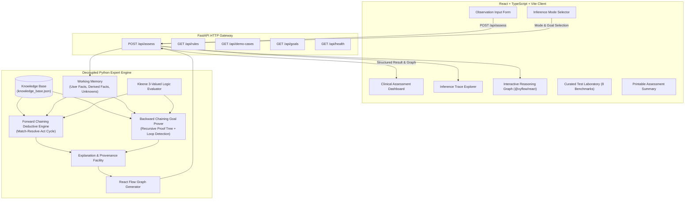

# RenalLogic AI: System Architecture

## 1. Architectural Overview

RenalLogic AI is engineered as an **explainable, decoupled expert system** designed for academic evaluation in an Artificial Intelligence subject competition. The architecture separates symbolic clinical inference, RESTful service interfaces, and modern reactive client visualization.

---

## 2. Layered Component Architecture

### A. Presentation Layer (React + TypeScript + Vite)
- **Framework**: Vite 8 with React 19 and TypeScript with strict typing.
- **Styling**: Tailwind CSS tailored to an academic healthcare research aesthetic (crisp dark navy typography, deep teal accents, subtle borders, high contrast).
- **Interactive Graphing**: `@xyflow/react` for visualizing the inference path (Fact nodes $\rightarrow$ Rule nodes $\rightarrow$ Derived conclusions $\rightarrow$ Composite risk target).
- **State Management**: Reactive component state with typed API services (`api.ts`).
- **Print Engine**: Dedicated print media stylesheets for generating formal clinical assessment reports with unique case identifiers.

### B. Service Layer (FastAPI + Pydantic)
- **FastAPI**: Asynchronous REST framework providing endpoint validation, automatic OpenAPI / Swagger documentation (`/docs`), and CORS handling for local pairing with Vite.
- **Pydantic V2**: Strongly-typed schema validation enforcing numerical bounds (e.g., eGFR $\in [0, 300]$, UACR $\in [0, 10000]$) and tri-state enum constraints (`'yes' | 'no' | 'unknown'`).
- **Decoupled Boundary**: The AI engine is imported into FastAPI as a standalone library with zero HTTP framework coupling, allowing pure CLI and Python script execution.

### C. Symbolic AI Engine (`engine.py`, `forward_chaining.py`, `backward_chaining.py`)
- **Declarative Knowledge Base**: Version-controlled JSON schema storing production rules with antecedents, consequents, priority tiers, clinical explanations, and KDIGO 2024 source citations.
- **Working Memory**: Dynamic assertion container separating user-supplied facts, rule-derived facts, and explicit unknown facts.
- **Kleene 3-Valued Logic**: Supports truth states `{TRUE, FALSE, UNKNOWN}`. Missing observations evaluate to `UNKNOWN` (`None`) and are never assumed to be `False`.
- **Forward Chaining Engine**: Data-driven deductive chainer implementing the classical Match-Resolve-Act cycle with deterministic priority agenda conflict resolution and cycle prevention.
- **Backward Chaining Engine**: Goal-directed recursive reasoner searching candidate rules, proving subgoals, preventing infinite circular recursion via goal path stacks, and returning explicit three-state results (`SUPPORTED`, `NOT_SUPPORTED_BY_AVAILABLE_EVIDENCE`, `UNDETERMINED`).
- **Explanation Facility**: Generates human-readable rule traces, matched premise tables, and serialized React Flow graph representations.

---

## 3. Data Flow

1. **User Observation Entry**: The clinician or student enters laboratory values (eGFR, UACR) and toggles chronicity persistence and comorbidity history (Yes/No/Unknown).
2. **Payload Delivery**: Input is transmitted to `POST /api/assess` with chosen inference mode (`forward` or `backward`) and optional target hypothesis.
3. **Working Memory Initialization**: Working Memory is initialized; absent or empty fields are registered explicitly as `UNKNOWN`.
4. **Deductive Execution**:
   - In **Forward Mode**, the forward chainer applies matching rules iteratively until quiescence.
   - In **Backward Mode**, the backward chainer evaluates the target hypothesis recursively, constructing a proof tree and flagging any missing prerequisite facts.
5. **Trace & Graph Serialization**: The engine constructs a step-by-step trace and graph nodes/edges.
6. **Reactive Client Render**: The frontend renders the composite KDIGO heat map risk badge, staging cards, chronological rule trace, and interactive `@xyflow/react` reasoning graph.
